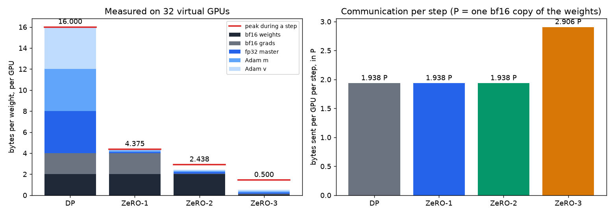
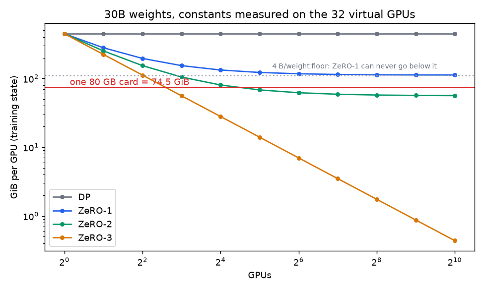
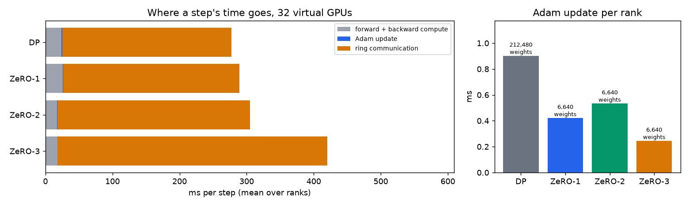
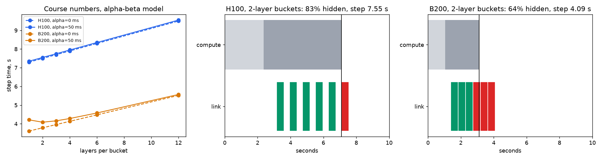

# ZeRO on 32 virtual GPUs: data parallelism and ZeRO-1, 2 and 3, by hand

Session 12 assignment: make 32 virtual GPUs, run a demo model on top of them, simulate ZeRO-1, ZeRO-2 and ZeRO-3, and show how memory and computation change.

**What's in this folder:**
- **Notebook:** [`s12_zero_on_32_virtual_gpus.ipynb`](s12_zero_on_32_virtual_gpus.ipynb), committed with its outputs.
- **Every number in one file:** [`submission_artifacts/s12_numbers.json`](submission_artifacts/s12_numbers.json). The tables below are copied from it.
- **Code:** [`zsim/`](zsim). The collectives, the four arrangements and the memory ledger are all written by hand.

> **Before submitting:** the [In my own words](#in-my-own-words) section at the end is for me to fill in. It's where I explain the concepts myself, as the assignment asks.

## Run it

```bash
cd s12
python3 -m venv .venv
.venv/bin/pip install torch numpy matplotlib jupyter nbformat nbclient ipykernel
.venv/bin/python tests/test_zsim.py                 # 8 checks, about 40 s
.venv/bin/python -m ipykernel install --user --name s12-zero
.venv/bin/jupyter nbconvert --to notebook --execute --ExecutePreprocessor.kernel_name=s12-zero \
  --ExecutePreprocessor.timeout=2400 --output s12_zero_on_32_virtual_gpus.ipynb s12_zero_on_32_virtual_gpus.ipynb
```

The notebook takes about 5 minutes on a 10-core Apple M-series laptop. It makes no network calls, because `data/tinyshakespeare.txt` is committed. Every run is seeded, so the memory, byte counts, hashes and losses come out the same each time. Only the timings change between runs.

## How the 32 virtual GPUs work

| Piece | What it is | File |
|---|---|---|
| A virtual GPU | A separate OS process started with `torch.multiprocessing.spawn`. 32 processes share no memory, so anything a rank needs from another crosses a socket. | `zsim/run.py` |
| The wiring | `torch.distributed` with the gloo backend, used **only** for point-to-point `isend`/`irecv` | `zsim/comm.py` |
| Collectives | Ring reduce-scatter, all-gather and all-reduce, built from neighbour-to-neighbour sends. Each rank sends to rank+1 and receives from rank−1. Every byte sent is counted. | `zsim/comm.py` |
| Demo model | A character-level GPT on Tiny Shakespeare: 4 blocks, d = 64, 212,480 weights, bf16 matmuls, fp32 LayerNorm, softmax and loss. Global batch 32 × 64 characters, split evenly across ranks. | `zsim/model.py` |
| DP and ZeRO-1/2/3 | Each stage keeps its state in real tensors and registers each one in a ledger by its real storage size. Memory figures are read from that ledger, not computed from a formula. | `zsim/engine.py` |
| The course's formulas | Kept in a separate file and only ever printed next to the measurements | `zsim/theory.py` |

The model is cut into **units**: the embeddings, one unit per block, and the head. Each unit's weights live in one flat buffer, padded to a multiple of N. That buffer is what gets reduce-scattered, all-gathered, and (in ZeRO-3) freed.

**How ZeRO-3 is implemented.** Before a unit runs forward, its 1/N slices are all-gathered into the full buffer. Afterwards the buffer's storage is shrunk to zero bytes, though autograd still holds views of it. A hook on the unit's output fires when backward reaches that unit and gathers the buffer again. Once the unit's gradient has been accumulated, a second hook reduce-scatters it, keeps this rank's slice, and frees both the full gradient and the gathered weights. This is the same mechanism FSDP uses.

## Results

All results are for N = 32 unless a section says otherwise. "P" is one bf16 copy of the weights, 2 bytes per weight.

### 1. The collectives

- **Each phase sends (N−1)/N of the data.** Reduce-scatter and all-gather each send 31/32 = 0.969 × the input per rank, so all-reduce sends 1.938 ×.
- **Reduce-scatter then all-gather equals all-reduce, bit for bit.**
- **The ring matches gloo's own `all_reduce` to within 7.6e-6.** That's fp32 rounding from adding in a different order.

### 2. Memory per GPU, measured on 32 ranks

| Bytes per weight | bf16 weights | bf16 grads | fp32 master | Adam m | Adam v | **Total** | Course formula | Peak in a step |
|---|---|---|---|---|---|---|---|---|
| DP | 2 | 2 | 4 | 4 | 4 | **16.000** | 16 | 16.000 |
| ZeRO-1 | 2 | 2 | 0.125 | 0.125 | 0.125 | **4.375** | 4 + 12/32 | 4.375 |
| ZeRO-2 | 2 | 0.0625 | 0.125 | 0.125 | 0.125 | **2.4375** | 2 + 14/32 | 2.908 |
| ZeRO-3 | 0.0625 | 0.0625 | 0.125 | 0.125 | 0.125 | **0.500** | 16/32 | 1.441 |



- **All 32 ranks hold exactly the same amount.** Every stage splits the state evenly, so no GPU is the odd one out.
- **Peak is higher than steady state for ZeRO-2 and ZeRO-3.** ZeRO-2 briefly holds one unit's full gradient before reduce-scattering it. ZeRO-3 briefly holds one unit's gathered weights and that unit's full gradient. Either way, the extra is one unit's worth (one transformer block at most), never the whole model.
- **Activations are the same in every stage.** The bytes saved for backward are 1,082,628 per rank in all four. ZeRO doesn't touch activations; the course's Section 7 note says they are extra.

### 3. Communication per step, measured

| | Collectives each rank runs | Sent per rank | Formula |
|---|---|---|---|
| DP | all-reduce of gradients (0.969 + 0.969) | **1.938 P** | 2(N−1)/N · P |
| ZeRO-1 | reduce-scatter of gradients 0.969, all-gather of updated weights 0.969 | **1.938 P** | 2(N−1)/N · P |
| ZeRO-2 | the same two, with the reduce-scatter done during backward | **1.938 P** | 2(N−1)/N · P |
| ZeRO-3 | all-gather of weights in forward 0.969, all-gather again in backward 0.969, reduce-scatter of gradients 0.969 | **2.906 P** | 3(N−1)/N · P |

The course's "2P" and "3P" are the large-N limits of these numbers.

### 4. Same arithmetic, same answer

- **All four arrangements finish bit-identical.** After 30 steps, DP, ZeRO-1, ZeRO-2 and ZeRO-3 produce the same final fp32 weights (sha256 `3fde834bf60ea999…`) and the same loss at every step.
  - The ring fixes the order of addition: chunk c always starts on rank c+1 and finishes on rank c.
  - Adam is elementwise and written with one IEEE operation per line, so updating a 1/N slice gives the same bits as updating everything.
- **In fp32, 32 ranks match one process with the whole batch.** The loss gap averages 1.5e-5 over 30 steps, and the only difference is the order of addition. This is the course's claim that DP is mathematically the same as one GPU with a bigger batch.
- **In bf16, the same gap averages 2.6e-2.** The cause is rounding in the gradient sum, which the next table separates out.

**Does the number of ranks change the answer in bf16?** Loss is averaged over steps 21–30. The reference is full fp32 on one process, at 2.9287.

| Ranks | Gradients summed in | Gap to fp32 reference | DP == ZeRO-2? | DP sends | ZeRO-2 sends |
|---|---|---|---|---|---|
| 1 | bf16 | 0.0057 | yes | 0 | 0 |
| 4 | bf16 | 0.0171 | yes | 1.500 P | 1.500 P |
| 4 | fp32 | 0.0008 | yes | 3.000 P | 2.250 P |
| 32 | bf16 | 0.0220 | yes | 1.938 P | 1.938 P |
| 32 | fp32 | 0.0165 | yes | 3.875 P | 2.906 P |

- **With bf16 sums, the gap grows with N.** Every ring hop rounds a partial sum back to bf16.
- **Summing in fp32 closes almost all of the gap at N = 4, but only about a quarter of it at 32.** At 32 ranks each rank's gradient comes from one sequence and is rounded to bf16 before it is sent, and that rounding stays.
- **fp32 sums double DP's traffic but raise ZeRO-2's by only half.** ZeRO-2 sends just its gradient reduce-scatter in fp32 and keeps its weight all-gather in bf16.

### 5. Memory as N grows, and scaling up to 30B

Measured bytes per weight at N = 1, 2, 4, 8, 16 and 32. Each row is fitted to `a + b/N`:

| | N=1 | 2 | 4 | 8 | 16 | 32 | Fitted a (in full) | Fitted b (split N ways) |
|---|---|---|---|---|---|---|---|---|
| DP | 16 | 16 | 16 | 16 | 16 | 16 | 16.000 | 0.000 |
| ZeRO-1 | 16 | 10 | 7 | 5.5 | 4.75 | 4.375 | 4.000 | 12.000 |
| ZeRO-2 | 16 | 9 | 5.5 | 3.75 | 2.875 | 2.4375 | 2.000 | 14.000 |
| ZeRO-3 | 16 | 8 | 4 | 2 | 1 | 0.5 | 0.000 | 16.000 |

The fit recovers the course's split exactly from measurement. Applying those constants to 30 billion weights reproduces the course's Section 7 table to one decimal:

| GiB per GPU, 30B | 8 GPUs | 16 | 32 | 64 |
|---|---|---|---|---|
| DP | 447.0 | 447.0 | 447.0 | 447.0 |
| ZeRO-1 | 153.7 | 132.7 | 122.2 | 117.0 |
| ZeRO-2 | 104.8 | 80.3 | 68.1 | 62.0 |
| ZeRO-3 | 55.9 | 27.9 | 14.0 | 7.0 |



- **The budget is 2.667 bytes per weight.** An 80 GB card (74.5 GiB) divided by 30B weights.
- **DP and ZeRO-1 never fit, at any N.** They keep 4 bytes per weight in full on every card (the bf16 weights and gradients), and that alone is 111.8 GiB. The model size at which that 4-byte floor exactly fills a card is 20B weights.
- **ZeRO-2 fits from N = 22.** The course says "from 32", counting in powers of two.
- **ZeRO-3 fits from N = 6.** The course says "from 8".
- **All of these leave room for nothing else.** They count training state only; activations come on top.

### 6. How computation changes

Mean over steps 2–30 and over all 32 ranks. These are 32 processes on 10 cores, so the absolute times are inflated, and the comparisons between stages are what matter.

| | Step (ms) | Forward | Backward | Communication | Adam | Weights Adam updates per rank |
|---|---|---|---|---|---|---|
| DP | 277.5 | 5.7 | 17.3 | 252.6 | 0.90 | 212,480 |
| ZeRO-1 | 289.4 | 6.3 | 19.0 | 263.2 | 0.42 | 6,640 |
| ZeRO-2 | 305.2 | 4.5 | 185.2 | 287.6 | 0.53 | 6,640 |
| ZeRO-3 | 420.1 | 133.1 | 286.7 | 402.0 | 0.24 | 6,640 |



- **The forward and backward compute is the same in every stage.** Each rank processes its own sequence.
- **ZeRO cuts the optimizer's work 32-fold** (6,640 weights instead of 212,480). The time only halves at this tiny size, because the fixed cost of launching each elementwise operation dominates. At 30B the work dominates instead.
- **ZeRO-2 moves the reduce-scatter into the backward pass.** That's why its backward column grows and its after-backward work shrinks.
- **ZeRO-3 puts communication on the critical path of the forward pass.** No unit can run until its weights have been gathered, and it sends 1.5 × as much in total.
- **On this machine, communication dominates every step.** It is 10–22 × the compute, against 34% on the course's 64 H100s. Each ring phase is 31 sequential hops through the kernel's socket stack, and the model is tiny. Communication time doesn't scale down with model size, but compute does.

### 7. Offload: ZeRO-2 with the optimizer state in host memory

| Bytes per weight, N=32 | Measured | Formula |
|---|---|---|
| Device (bf16 weights + gradient slice) | 2.0625 | 2 + 2/N |
| Host (master + Adam slices) | 0.375 | 12/N |
| PCIe per step (gradient slice to host, updated weight slice back) | 0.125 | 4/N |

- **The maths is unchanged.** The weights are bit-identical to plain ZeRO-2.
- **At 30B, ZeRO-2 with offload fits from N = 3,** because 2 + 2/N ≤ 2.667. On 8 GPUs it uses 62.9 GiB of 74.5. Plain ZeRO-2 needs at least 22 (32 in powers of two).
- **The price is 335 GiB of host memory per 8-GPU node.**
- **PCIe traffic is small.** It's 250 ms per step at 60 GB/s on 8 GPUs.
- **CPU Adam is the bottleneck, not PCIe.** The CPUs must run Adam for 3.75B weights per GPU on every step. At the measured 236M weights per second per core, that's about 16 core-seconds per GPU per step.

Every rank is a CPU process, so "device" and "host" are two separate ledgers rather than two physical memories. The bytes are measured, and the time is priced with the course's PCIe figure.

### 8. Gradient buckets and overlap

Measured with DP on 8 ranks and a 12-block model, matching the course widget's 12 layers.

| Units per bucket | Transfers | Step, serial (ms) | Step, overlapped (ms) | Comm, serial | Comm, overlapped |
|---|---|---|---|---|---|
| 1 | 14 | 149.4 | 149.1 | 45.5 | 108.4 |
| 2 | 7 | 141.6 | 122.5 | 34.6 | 69.7 |
| 4 | 4 | 124.8 | 128.5 | 23.3 | 58.8 |
| 7 | 2 | 118.0 | 111.8 | 15.7 | 25.3 |
| 14 | 1 | 114.5 | 114.0 | 12.3 | 11.9 |

- **Each all-reduce costs about 2.6 ms before any data moves.** That's the fitted slope of communication time against number of transfers, from 14 sequential socket hops. Bigger buckets pay that fixed cost less often.
- **Overlap saves less than it would on a GPU.** It runs the communication thread on the same CPU cores as the backward pass, which roughly doubles the measured communication time. On a GPU, NCCL moves data while the compute units keep working.
- **Overlap doesn't change the maths.** It gives bit-identical weights at every bucket size.

**The course's Section 10, in its own numbers.** `zsim.theory.bucket_timeline` is an α-β model:
- 12 layers;
- 2.40 s of gradient traffic per step;
- 7.10 s (H100) or 3.12 s (B200) of compute per step, with backward taken as 2/3 of it;
- each transfer costs α plus its share of the bytes.



It reproduces the course's numbers:
- **No hiding:** 9.50 s per step on H100 and 5.52 s on B200.
- **On H100, the smallest bucket is best.**
- **83% hidden at 2-layer buckets on H100.** The last of six buckets can only start after backward has finished, so 5/6 of the transfer time is hidden whatever α is.

It also shows the condition behind the course's claim that **2-layer buckets are best on B200**. That only holds when each transfer's fixed cost is about 30 ms or more. At B200 speed, one layer's backward takes 0.17 s and one layer's gradients take 0.20 s to send. The link falls behind, transfers queue, and once they queue, merging them saves start-up costs and loses nothing. With α near zero, single-layer buckets still win on B200.

## Trade-offs at a glance

All of these are measured here or derived from the table above.

| | Memory per GPU | Sent per step | Extra work | Fits 30B on 80 GB cards |
|---|---|---|---|---|
| DP | 16 B/weight | 2P | Adam on every weight, on every GPU | never |
| ZeRO-1 | 4 + 12/N | 2P | none; Adam runs on 1/N | never (4 B floor) |
| ZeRO-2 | 2 + 14/N | 2P | none; gradient reduce-scatter moves into backward | N ≥ 22 |
| ZeRO-3 | 16/N | 3P | weights gathered before every unit, forward and backward | N ≥ 6 |
| ZeRO-2 + offload | 2 + 2/N on GPU, 12/N on host | 2P + 4/N PCIe | Adam runs on the CPU | N ≥ 3 (host RAM permitting) |

## Things I'd flag

- **Bit-identical results depend on how gradients are bucketed.** DP with multi-unit buckets moves the ring's chunk boundaries, so each element is summed in a different order and the result stops matching ZeRO bit for bit. It is still correct to rounding. With one unit per bucket, which is the default here, all four arrangements agree exactly.
- **Faster hardware makes communication matter more.** The course's 34% → 77% communication-to-compute ratio, from H100 to B200, is the same effect seen here in the extreme. This laptop computes a tiny model quickly and communicates slowly, so communication is 10–22 × compute.
- **What's not simulated:** activation checkpointing, gradient clipping (with ZeRO, the global gradient norm needs an all-reduce of one scalar), prefetching the next unit's weights in ZeRO-3, and multi-node bandwidth tiers.

## Files

```
s12/
├── s12_zero_on_32_virtual_gpus.ipynb   # the submission notebook, executed
├── zsim/
│   ├── comm.py      # ring reduce-scatter / all-gather / all-reduce over isend/irecv, byte counter
│   ├── model.py     # the demo GPT as plain functions of flat per-unit weight buffers
│   ├── engine.py    # one rank: DP / ZeRO-1 / ZeRO-2 / ZeRO-3 / offload / buckets, memory ledger
│   ├── run.py       # spawns N processes, gathers results
│   └── theory.py    # the course's formulas and the bucket-timeline model
├── tests/test_zsim.py
├── data/tinyshakespeare.txt
└── submission_artifacts/                # figures + s12_numbers.json
```

## In my own words

> *To fill in before submitting. Every number above is measured, but the explanations here have to be mine. Suggested prompts:*

**1. What does each stage remove, and why does it save that much?** Go through the 16 bytes per weight and say which ones ZeRO-1, ZeRO-2 and ZeRO-3 stop duplicating.

*…*

**2. Why do ZeRO-1 and ZeRO-2 cost no more communication than plain data parallelism?** Use the fact that an all-reduce is a reduce-scatter followed by an all-gather.

*…*

**3. Why does ZeRO-3 cost 3P instead of 2P? Where in the step does that extra communication land, and why does that make it worse than the volume alone suggests?**

*…*

**4. Pros and cons of each stage, and when I would pick it.** Think about a 1B model on 8 GPUs, a 30B model on 8 GPUs, a 30B model on 64 GPUs, and V5.

*…*

**5. What surprised me in the measurements?** For example: the bf16 gradient-sum drift as N grows, ZeRO-2 being cheaper than DP once gradients are summed in fp32, the B200 bucket result depending on α, or the Adam time not falling 32×.

*…*
