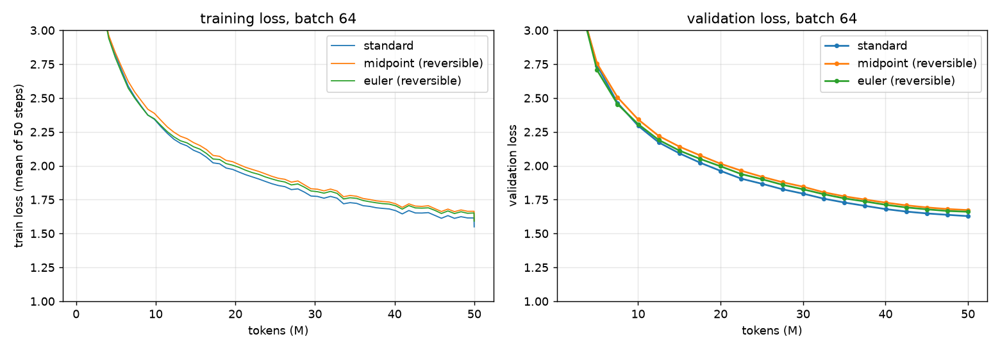
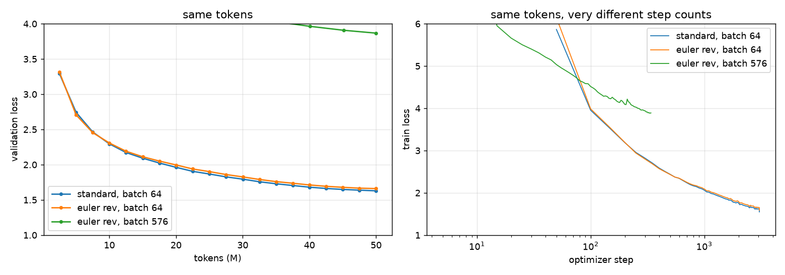
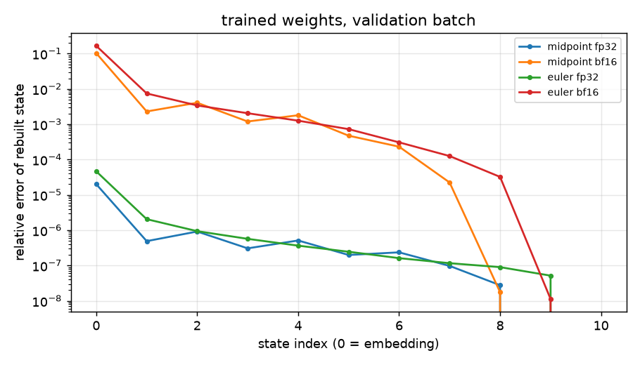
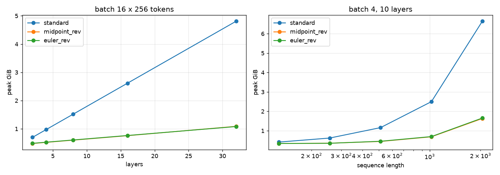

# Session 13: training a 20M LLM with reversible residual streams

**Assignment.**
1. Train a 20M LLM on 50M tokens at a fixed batch size.
2. Train it again with reversibility, and report which variant worked (midpoint, Euler, …).
3. Train again with reversibility pushed to the maximum batch size.
4. Report final loss, speed (tokens/s), peak memory and other findings.

**Notebook:** [`s13_reversible_training.ipynb`](s13_reversible_training.ipynb), executed with every output.
Every number below comes from that notebook, or from the run logs in `results/`, via
`submission_artifacts/s13_numbers.json`.

**Hardware:** everything ran on one Apple M1 Pro (32 GB unified memory), with PyTorch 2.14 on the MPS backend in
fp32. I used the Mac instead of Colab. The memory budget for "maximum batch" is 16 GiB, the size of a Colab T4.

## Results

| run (50M tokens each) | variant | batch | final val loss | final train loss | speed (tok/s) | peak memory | wall time |
|---|---|---|---|---|---|---|---|
| 1. baseline | standard residual | 64 | **1.602** | 1.549 | **16,068** | 6.47 GiB | 52 min |
| 2a. reversible | midpoint, h = 0.5 | 64 | 1.650 | 1.598 | 13,067 | **1.85 GiB** | 64 min |
| 2b. reversible | Euler (two-stream coupling), h = 0.5 | 64 | 1.638 | 1.591 | 13,244 | 1.88 GiB | 63 min |
| 3. reversible, max batch | Euler, h = 0.5 | **576** | 3.865 | 3.890 | 3,413 | 15.00 GiB | 243 min |

- **Val loss** is the mean over 100 batches of the TinyStories validation file.
- **Train loss** is the mean of the last 50 steps.
- **Speed** counts training steps only; evaluation is excluded.
- **Peak** is the largest allocated byte count during one full training step: weights, gradients, Adam state,
  activations and loss.

**Which variant worked for me: Euler (two-stream coupling).** At the fixed batch it beat the midpoint rule by
0.011 in validation loss, and it was 1.4% faster. Both variants trained without trouble at h = 0.5. The gap is
about what I'd expect from seed noise, so "Euler won" is a weak result. Section 2 explains why, on stability
grounds, I'd still choose midpoint with a = 1 or Euler, and never the blended midpoint.

**The headline trade.**
- **Memory and speed:** at the same batch, reversibility cut peak memory 3.5× (6.47 → 1.85 GiB) and cost about
  18% throughput.
- **Loss:** it cost 0.04–0.05 in validation loss after 50M tokens. The 5M-token sweep showed no gap, so the gap
  opened later in training.
- **Batch size:** under a 16 GiB budget the reversible model fits 4.5× the standard model's batch (576 against 128),
  and 11× (1,408) once the loss is also computed in chunks.
- **Max-batch run:** pushing to the maximum batch made *this* run much worse: loss 3.87 against 1.64, and 3.9× slower.
  Section 3 explains both. On this machine, neither has much to do with reversibility.



## 1. What I built

| file | what it does |
|---|---|
| `rev/data.py` | downloads TinyStories (the first 270 MB of the GPT-4 training file, plus the validation file), trains an 8,192-token byte-level BPE, and writes 55M training tokens and 2M validation tokens as uint16. Every run reads the same tokens in the same order. |
| `rev/model.py` | GPT model: d = 384, 10 layers, 6 heads, sequence 256, tied 8,192-token head, **20,954,880 parameters**. Three residual rules, each runnable with stored activations or reversibly (`_Reversible`). |
| `rev/train.py` | AdamW (β = 0.9/0.95, wd 0.1, clip 1.0), 1M-token warmup, cosine decay to 10%, lr 1.5e-3 at batch 64. `Peak` samples allocated memory after every aten op. |
| `rev/experiments.py` | runs the whole experiment in order: sweep → three main runs → max-batch search → max-batch run → LR check. Finished runs are cached in `results/`. |
| `rev/analysis.py` | reconstruction drift, gradient agreement, memory sweeps, phase timing |
| `tests/test_rev.py` | 11 tests, for example: reversible gradients equal stored gradients, the inverse rebuilds the input, only two states are saved, and chunked loss equals full loss |
| `tools/build_notebook.py` | builds the notebook |
| `tools/remeasure_peaks.py` | re-measures the peaks of runs trained before the peak sampler was fixed (see "Things to flag") |

The vocabulary is 8,192 instead of GPT-2's 50,257. With GPT-2's, the embedding alone would be 19M of the 20M
parameters.

### The three residual rules

$p^\ell$ is the residual stream entering layer $\ell$. $f_\ell(p) = A(p) + M(p + A(p))$ is the whole block's update:
attention, then the MLP.

| rule | forward | how the backward pass rebuilds the input | stored for backward |
|---|---|---|---|
| standard | $p^{\ell+1} = p^\ell + f_\ell(p^\ell)$ | it can't: $p^\ell$ sits inside $f_\ell(p^\ell)$ | every layer's activations |
| midpoint | $p^{\ell+1} = a\,p^{\ell-1} + (1-a)\,p^\ell + 2h\,f_\ell(p^\ell)$ | $p^{\ell-1} = (p^{\ell+1} - (1-a)p^\ell - 2h f_\ell(p^\ell))/a$ | $p^{L-1}, p^L$ |
| Euler coupling | $y_1 = x_1 + h A_\ell(x_2)$, $y_2 = x_2 + h M_\ell(y_1)$ | $x_2 = y_2 - h M_\ell(y_1)$, $x_1 = y_1 - h A_\ell(x_2)$ | $x_1^L, x_2^L$ |

- **Midpoint with a = 1** is the course's rule. With a = 0.5 it is the "blend" setting the course quotes from
  Lightning LM.
- **A plain Euler step** $p + h f(p)$ is just the standard block. Its inverse means solving $p = p^{\ell+1} - h f(p)$,
  which needs iteration. Two coupled streams (RevNet, Reformer) make each half-step an Euler step whose inverse is a
  single subtraction.

**How the reversible backward works** (`_Reversible` in `rev/model.py`):
1. It runs the forward pass under `no_grad` and saves only the top two states.
2. Walking down the stack, it rebuilds each layer's input from that layer's output.
3. It recomputes the layer with gradients on, and backpropagates through it.

In float64 its gradients equal ordinary autograd's to about 1e-15, so the saving costs no correctness.

## 2. Choosing the variant: the h / blend sweep

The candidates were trained for 5M tokens each at batch 64. The sweep used the stored-activation form of each rule,
which is the same maths and faster.

| rule | h | a | val loss @ 5M |
|---|---|---|---|
| standard | – | – | 2.781 |
| midpoint | 0.125 | 1 | 2.902 |
| midpoint | 0.25 | 1 | 2.781 |
| midpoint | **0.5** | 1 | **2.771** |
| midpoint | 1.0 | 1 | 2.777 |
| midpoint (Lightning LM setting) | 0.25 | 0.5 | 2.787 |
| Euler | **0.5** | – | **2.760** |
| Euler | 1.0 | – | 2.837 |

- **Step size matters for both rules.** For midpoint, a step that is too small (h = 0.125) is clearly worse: the
  stack can't move the stream far enough in 10 layers. Euler at h = 1 is 0.08 worse than at h = 0.5. Euler's two
  half-steps each add a full update, so h = 1 doubles the effective step.
- **Nothing diverged in training,** so at 10 layers I couldn't see the "only marginally stable" claim in the loss.
  It shows up clearly in the reconstruction (next point).
- **The blend coefficient is dangerous for reversibility.** The inverse divides by a at every layer, so rounding
  error grows like (1/a)^L. Measured in fp32 on untrained weights:

  | layers | midpoint a = 1 | midpoint a = 0.5 | Euler |
  |---|---|---|---|
  | 10 | 1.4e-6 | 1.5e-4 | 9.4e-7 |
  | 20 | 1.6e-6 | **1.1e-1** | 1.0e-6 |
  | 40 | 1.7e-6 | **6.8e+4** | 1.1e-6 |
  | 80 | 1.7e-6 | **5.3e+16** | 1.2e-6 |

  With a = 0.5 past about 20 layers, the rebuilt activations are garbage, so the gradients are too. Midpoint with
  a = 1 and the Euler coupling don't grow at all. **That stability is why I'd pick one of those two.** I can't tell
  which blend form Lightning LM actually uses; mine is one natural reading, and this is what it does.

## 3. Maximum batch, and why it lost

### How much more fits

I searched under a 16 GiB budget: fit peak-vs-batch from two measured batches, then step by 64 until the largest
batch whose measured peak fits.

| model | max batch | tokens per step | peak | MB per extra sample |
|---|---|---|---|---|
| standard | 128 | 32,768 | 12.71 GiB | 104.6 |
| Euler, activations stored | 128 | 32,768 | 12.71 GiB | 104.6 |
| **Euler, reversible** | **576** | 147,456 | 15.00 GiB | 27.5 |
| Euler, reversible + chunked loss (measured, not trained) | 1,408 | 360,448 | 15.79 GiB | 11.0 |

The ratio is **4.5×**, not the paper's 9.88×. The reason is where the reversible model's memory goes at batch 64:

| part | GiB |
|---|---|
| training state: weights, gradients, Adam, fp32 | 0.31 |
| the two boundary states | 0.05 |
| loss: logits + log-softmax + gradient (3 × 0.50) | 1.50 |
| left over | 0.02 |
| **measured peak** | **1.88** |

Once the activations are gone, the peak *is* the loss. The 8,192-way logits per token are 21× the 384-wide hidden
state. That is the course's "reversibility moves the binding term" seen directly. The term only moved to the LM
head, not to ZeRO's training state, because the model is small.

Computing the loss in chunks of 8,192 tokens, with logits recomputed in backward, brings the peak to 1.01 GiB. The
remaining 0.65 GiB is one layer's rebuild-and-backward working set. The max batch then becomes 1,408, which is
**11×** the standard model's and in line with the paper.

### Why the max-batch run trained so much worse

| | batch 64 | batch 576 |
|---|---|---|
| optimizer steps for 50M tokens | 3,051 | 339 |
| final val loss | 1.638 | 3.865 |
| tok/s | 13,244 | 3,413 |

**1. Too few steps, and a learning rate I didn't tune for them.** The same 50M tokens became 339 updates instead
of 3,051. Per step, the big batch led only at the start; by step 100 it was behind:

| step | 50 | 100 | 200 | 300 |
|---|---|---|---|---|
| batch 64 | 6.15 | 3.99 | 3.19 | 2.80 |
| batch 576 | 5.03 | 4.52 | 4.09 | 3.94 |

Each big-batch step averages 9× more tokens, so lacking steps alone would leave it *at least* level per step. It
fell behind, and the gradient norm spiked to 48 at step 180 and to 9.5e7 at step 205. Clipping caught both. My
reading is that the learning rate was wrong for this batch: it used the √batch rule, giving 4.5e-3.

A 60-step check at batch 256 gave val loss 4.64 at lr 1.5e-3, 5.18 at 3e-3 and 4.93 at 6e-3. The lowest learning
rate was best, which suggests √-scaling overshot. But the result isn't monotonic, so it is also noisy.

**Conclusion:** at a fixed token budget, "maximum batch" is a memory question, and whether it trains well is a
separate optimization question. Reversibility answers the first. The second needs its own learning-rate tuning, and
past the critical batch size more tokens per step stop helping.

**2. An MPS performance cliff, not reversibility.** Throughput against batch size:

| batch | 16 | 64 | 128 | 256 | 384 | 576 |
|---|---|---|---|---|---|---|
| standard (tok/s) | 13,324 | 16,171 | 16,960 | does not fit | – | – |
| Euler reversible (tok/s) | – | 13,468 | 14,002 | 5,555 | 5,518 | 5,429 |

The reversible model's throughput drops 2.5× between batch 128 and 256. It is using only 3–7 GiB there, so memory
isn't the cause. A separate probe found the standard model falls off at the same point, between 128 and 192.
- The phase split puts it all in the backward pass, which runs 4× slower per sequence.
- Every weight gradient is a matmul whose inner dimension is the batch's token count, and 128 × 256 = 2^15.
- On MPS, `(384 × K) @ (K × 1536)` runs at 3.35 TFLOP/s for K = 32,768 and **0.38 TFLOP/s for K = 32,769**, about 9×
  slower.

The run's 3,413 tok/s is that cliff, plus swapping: 16 GiB allocated used most of the Mac's memory, which is why
it falls below the 5.4k measured at that batch without swap. On this backend a large batch only keeps its speed if it is split
into micro-batches of at most 128 sequences with gradient accumulation. At that point a bigger batch no longer needs
more memory, so reversibility's saving buys nothing here.

The paper's speed result (114 against 57 samples/s from batch 874 against 52) relies on a GPU that is underused at
small batch. My machine is the opposite case.



## 4. Checking the course's other claims

| claim (course, Section 16–17) | measured here | verdict |
|---|---|---|
| A reversible stack's activation memory doesn't depend on depth | Peak per extra layer at batch 16: standard 0.137 GiB; reversible 0.020 GiB. That 0.020 is exactly one layer's weights + Adam state (0.0198 GiB); the activations add only +0.03 to +0.47 MiB per layer. | **Confirmed** |
| Recomputation costs 30–50% per step | Step time +23% (midpoint) and +20% (Euler); backward +63% / +59%. The reversible forward is *faster* (253 against 376 ms), because it stores nothing. | **Below the quoted range** at this size |
| ~10× larger batch (paper: 9.88× on H100) | 4.5× as is; 11× with the loss chunked | **Holds only once the LM head is fixed too** |
| Activations ≈ 34 bytes per token per hidden unit per layer (16-bit) | 75.5 bytes in fp32 for the standard model: ≈ 2 × 34, plus the attention scores the MPS attention kernel keeps | **Consistent** |
| Memory grows with sequence length | At 2,048 tokens, batch 4: standard 6.64 GiB, reversible 1.63 GiB. Both grow; the standard one grows 4× faster. | **Confirmed** |
| Forward must be deterministic (no dropout) | The model has no dropout; reconstruction in fp32 is good to 2e-5 | **Respected** (not tested with dropout) |
| "Only marginally stable" | Training was fine at all h tried, but the blended inverse explodes with depth (Section 2) | **Confirmed for the blend** |

### How exact is "reversible" after training

On the trained weights and a validation batch, I rebuilt every state from the top two and compared gradients
against stored autograd:

| | rebuilt input, relative error | gradient relative error | gradient cosine |
|---|---|---|---|
| midpoint, fp32 | 2.0e-5 | 2.0e-5 | 1.000000 |
| Euler, fp32 | 4.6e-5 | 3.2e-5 | 1.000000 |
| midpoint, bf16 autocast | 1.0e-1 | 1.3e-1 | 0.9915 |
| Euler, bf16 autocast | 1.7e-1 | 1.5e-1 | 0.9894 |

fp32 is effectively exact. **bf16 is not**: a 10–17% error in the rebuilt activations, and a gradient 13–15% off.
I trained in fp32, which on MPS was also faster than bf16 autocast. On a GPU in bf16 I'd keep the residual stream
and the inverse in fp32.




## 5. Cost

These are device-hours on this Mac for 50M tokens:

| run | hours | relative |
|---|---|---|
| standard, batch 64 | 0.86 | 1.00 |
| midpoint reversible, batch 64 | 1.06 | 1.23 |
| Euler reversible, batch 64 | 1.05 | 1.21 |
| Euler reversible, batch 576 | 4.06 | 4.69 |

At a cloud price of P per GPU-hour, each run costs hours × P. The ratios only carry over to a GPU with the same
speed-against-batch curve, and a large CUDA GPU doesn't have one.

## Things to flag

- **My first peak-memory numbers were wrong, and the first max-batch search ran out of memory because of them.**
  - MPS has no `max_memory_allocated`. My first sampler read memory at module boundaries and parameter gradients.
  - It missed the logits, log-softmax and gradient created inside `cross_entropy`. At batch 256 it reported 2.94 GiB
    where the truth was 6.80 GiB.
  - The search extrapolated from that and asked for an 11.5 GiB allocation.
  - `Peak` now samples after every aten op, on the backward thread too. All four runs' peaks were re-measured at
    their exact configs (`tools/remeasure_peaks.py`); the old figure is kept in each JSON as
    `peak_bytes_module_hooks`. Loss and speed didn't need re-running.
- **Speed is noisy on this machine.** Identical-cost sweep runs ranged from 13.0k to 15.3k tok/s. I treat speed
  differences under about 15% as noise, which includes the midpoint/Euler speed gap.
- **One seed per run.** Midpoint against Euler (0.011) is within that noise. Standard against reversible
  (0.04–0.05) probably isn't.
- **The max-batch run was swapping,** which made its time worse (about 4 h against an expected 2.5 h without swap).
- **The data is not in the repo** (390 MB). `python -m rev.data` downloads and tokenizes it again; the tokenizer
  file `data/bpe8192.json` is committed.

## Reproduce

```bash
python3 -m venv .venv && .venv/bin/pip install torch tokenizers numpy matplotlib nbformat nbconvert ipykernel pytest
.venv/bin/python -m rev.data             # download TinyStories, train the tokenizer, write data/*.bin
.venv/bin/python -m pytest tests -q      # 11 tests, ~2 s
.venv/bin/python -m rev.experiments      # all runs, about 9 h on an M1 Pro (cached in results/)
.venv/bin/python tools/build_notebook.py
.venv/bin/python -m ipykernel install --user --name s13-rev
.venv/bin/jupyter nbconvert --to notebook --execute --inplace --ExecutePreprocessor.timeout=-1 \
    --ExecutePreprocessor.kernel_name=s13-rev s13_reversible_training.ipynb
```

On CUDA the same code runs unchanged (`device()` picks CUDA). `Peak` also reads `torch.cuda.max_memory_allocated`.

---

## In my own words

*(To be written by me, not the agent.)*

1. **Why can a standard residual block not be run backwards, and what exactly do the midpoint rule and the Euler
   coupling change so that it can?**

   _…_

2. **The reversible model still stores two states. What are they, and why is that enough to rebuild every layer?
   Why does depth stop mattering?**

   _…_

3. **Reversibility cut my peak 3.5× at batch 64, but only allowed 4.5× the batch, not 10×. Where did the memory go,
   and what fixed it?**

   _…_

4. **My max-batch run had 4.5× the batch but a far worse loss and lower speed. Which part of that is reversibility,
   which part is the optimizer, and which part is my hardware?**

   _…_

5. **When would I *not* use reversibility? Think about the 20% compute cost, bf16 drift, dropout, the blend
   coefficient, and what ZeRO (Session 12) already divides.**

   _…_
