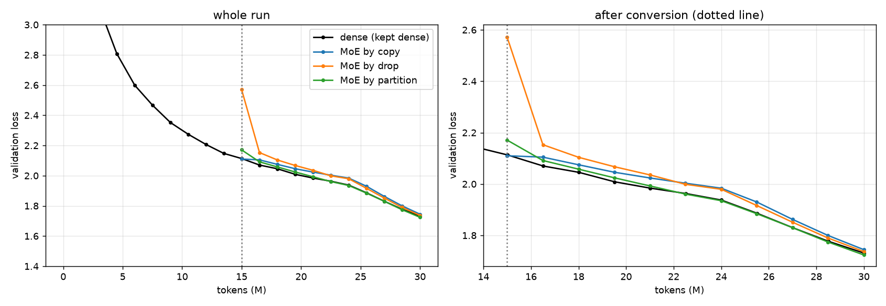
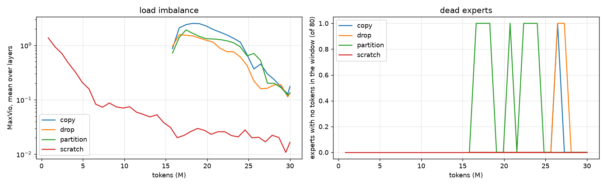
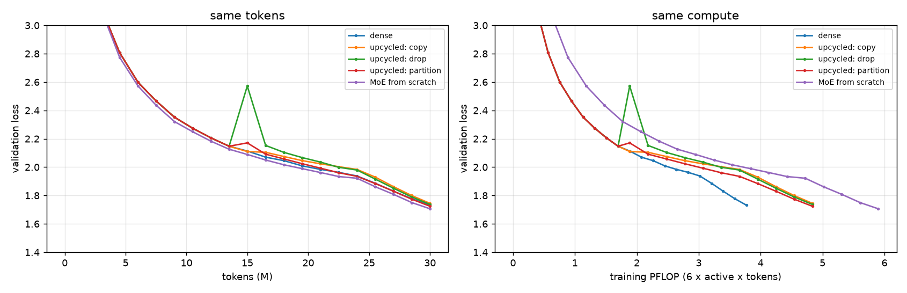
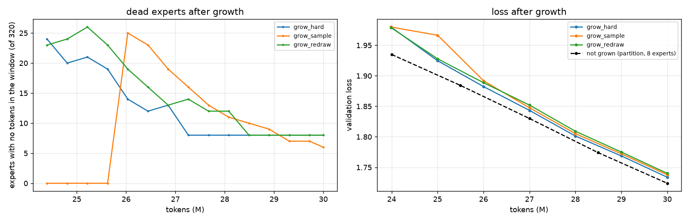
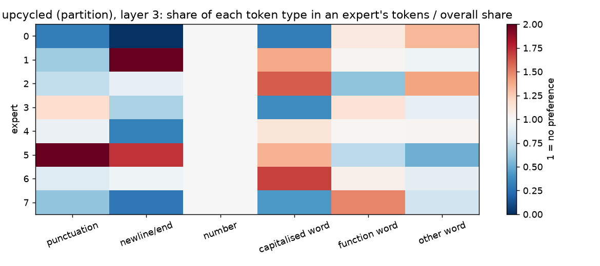

# Session 14: training a dense GPT and converting it into a mixture-of-experts

**Assignment:** "Train a Linear model and convert that into an MoE! Your call on model size and data trained on, but must show they continue to train and reduce loss!"

I trained a 21M-parameter dense GPT on TinyStories on an M1 Pro (MPS). Halfway through, at 15M of 30M tokens, I converted it into a mixture-of-experts three different ways and kept training each one on exactly the tokens the dense model would have seen next. Then I grew the best of them from 8 to 32 experts, and trained the same MoE from scratch for comparison. Every number below comes from `s14_dense_to_moe.ipynb` and `submission_artifacts/s14_numbers.json`.

## Results

**All three converted MoEs kept training and reduced loss.** Validation loss fell at 10 of 10 evaluations after conversion for each method:

| | val loss at conversion (15M) | after +1.5M tokens | at 24M | final (30M) | vs dense | tok/s | peak GiB |
|---|---|---|---|---|---|---|---|
| dense (kept dense) | 2.1132 | 2.0699 | 1.9375 | **1.7045** | — | 16,021 | 6.47 |
| MoE by copy | 2.1100 | 2.1045 | 1.9836 | 1.7178 | +0.0133 | 6,697 | 11.03 |
| MoE by drop (r = 0.5) | 2.5722 | 2.1529 | 1.9795 | 1.7105 | +0.0059 | 6,867 | 11.07 |
| MoE by partition + shared | 2.1710 | 2.0915 | 1.9349 | **1.6973** | **−0.0072** | 7,211 | 10.57 |
| MoE from scratch (0 → 30M) | — | — | 1.9220 | **1.6779** | **−0.0266** | 7,119 | 11.02 |



The four models:

| model | total params | active per token | training FLOPs per token |
|---|---|---|---|
| dense | 21.0M | 21.0M | 126 MFLOP |
| copy / drop (8 experts × 1,536, top-2) | 103.6M | 32.8M | 197 MFLOP |
| partition (dense FFN as shared expert + 8 × 768, top-2) | 68.2M | 32.8M | 197 MFLOP |
| partition grown to 32 experts (top-2 kept) | 209.8M | 32.9M | 197 MFLOP |

In short:
- **Copy is exactly the dense model at the moment of conversion**: 2.1100 vs 2.1100 on the same validation batches. A unit test checks this to 1e-12 in float64.
- **Only partition beat keeping the model dense**, by 0.007 at 30M tokens. Copy and drop finished behind the dense model even though they compute 1.56× more per token.
- **MoE from scratch was best of all** (1.6779), but it also spent the most compute.
- **Growing 8 → 32 experts made things worse** in all three variants (1.708 to 1.714, against 1.6973 for the ungrown model).

## 1. What I built

- **Data**: TinyStories, a byte-level BPE tokenizer with 8,192 tokens, sequences of 256, batch 64 (16,384 tokens a step). These are the same files as Session 13.
- **Dense model**: 10 layers, d = 384, 6 heads, GELU MLP with 1,536 neurons, tied head.
- **Training**: AdamW (β = 0.9 / 0.95, weight decay 0.1), learning rate 1.5e-3, gradient clip 1.0. The schedule is warm-up over 1M tokens, constant until 24M, then a linear decay to 10% at 30M.
- **One token axis for every run.** Every run reads the same stream of training tokens in the same order. A run converted at 15M starts reading at token 14,991,360 (on a step boundary), so it sees exactly what the dense run saw from there. It gets a new AdamW, since the experts and router are new tensors, and a 0.5M-token warm-up back to the schedule's learning rate.

### The MoE layer (`moe/model.py`)

- **Router**: a linear layer with no bias. Its logits are computed in fp32, then softmax, then top-2. The two chosen weights are renormalised to sum to 1.
- **Load balancing without an auxiliary loss** (the DeepSeek-V3 method): each expert has a selection bias. After every step, the bias goes up by 0.001 for an expert that got fewer tokens than average and down by 0.001 for one that got more. The bias only changes which experts are chosen; the mixing weights still come from the raw softmax. `test_bias_steers_selection_but_not_weights` checks this.
- **Dropless**: every expert processes every token routed to it. There is no capacity factor and no token is dropped.
- **Optional shared expert**, which every token goes through. Partition uses it.
- **Sampled selection** (Gumbel top-k without replacement) for the clone-growth experiment. It is used during training only.

### The three ways of converting (`moe/convert.py`)

| method | how each expert starts | the model right after conversion |
|---|---|---|
| copy (sparse upcycling) | 8 exact copies of the dense FFN; new router | exactly the dense model |
| drop (r = 0.5) | copy, then re-initialise a random half of each expert's neurons (normal with the dense weights' mean and std) | worse by 0.47 |
| partition + shared | dense FFN becomes the shared expert; each routed expert gets a random half (768) of the dense neurons | worse by 0.06 |

Active parameters per token are the same for all three, so they cost the same to train (`test_active_params_are_equal_across_methods`).

## 2. They kept training and reduced loss

- **Copy started where the dense model was but learned slowest.** After 1.5M tokens it had gained only 0.006, while the dense run gained 0.043. With 8 identical experts, the router gradient has nothing to tell them apart. The experts only diverge through the order in which they receive tokens, and that takes time.
- **Drop paid 0.47 at conversion and had recovered within 1.5M tokens** (2.15). It caught up with copy by 24M (1.980 vs 1.984) and finished ahead of it (1.7105 vs 1.7178). The redrawn halves give the experts a reason to differ from step one.
- **Partition was level with or ahead of dense at every evaluation from 24M** (1.935 vs 1.937, 1.830 vs 1.830 at 27M, 1.724 vs 1.731 at 30M on the 20-batch evals). It keeps the whole dense FFN as a shared expert, so every token still has the original function. The routed experts start from different halves of the neurons, so they are different from the start.

### Routing stayed healthy



MaxVio is (largest load − average load) / average load, measured over each 50-step window and averaged over the 10 layers:

| run | first window | last window | worst | dead experts, worst / last (of 80) |
|---|---|---|---|---|
| copy | 0.87 | 0.18 | 2.53 | 1 / 0 |
| drop | 0.95 | 0.14 | 1.56 | 1 / 0 |
| partition | 0.72 | 0.13 | 1.92 | 1 / 0 |
| scratch | 1.37 | 0.02 | 1.37 | 0 / 0 |

The bias-only balancing brought every run under 0.2, and no expert stayed dead.

## 3. Upcycled vs trained from scratch



Training compute is 6 × active parameters × tokens:

| run | final val | training compute |
|---|---|---|
| dense, 30M tokens | 1.7045 | 3.77 PFLOP |
| best upcycled (partition): 15M dense + 15M MoE | 1.6973 | 4.84 PFLOP |
| MoE from scratch, 30M tokens | 1.6779 | 5.90 PFLOP |

By tokens, scratch wins clearly. It was already ahead of dense at 24M (1.922 vs 1.937). Per unit of extra compute over dense, upcycling bought 0.007 for +28% and scratch bought 0.027 for +56%. I can't read an equal-compute comparison off the curves. Scratch at 4.84 PFLOP is at 24.6M tokens, still on the constant learning rate and not yet annealed, so it isn't a fair point. That would need a scratch run whose schedule ends at 4.84 PFLOP.

## 4. Growing 8 → 32 experts by cloning

At 24M I took the converted MoE with the lowest validation loss (partition, 1.935) and cloned each expert 4 times into a "family". Each copy's router row got noise of std 1e-3, and top-2 was kept, so compute per token is unchanged. I trained three versions to 30M, against the ungrown partition model's own 24M → 30M:

| run | val right after growth | final val | dead experts, worst / last (of 320) | families with all 4 alive / only 1 alive (of 80) | tok/s |
|---|---|---|---|---|---|
| not grown | 1.935 | **1.6973** | — | — | 7,211 |
| hard top-k | 1.980 | 1.7080 | 24 / 8 | 78 / 0 | 4,630 |
| sampled top-k for the first 1.5M tokens | 1.980 | 1.7133 | 25 / 6 | 78 / 0 | 4,643 |
| hard, half of each clone's neurons redrawn | 1.979 | 1.7141 | 26 / 8 | 78 / 0 | 4,711 |



- **Growth was not function-preserving, and it cost 0.045 straight away.** Before growth, top-2 mixed two *different* experts. After growth, the two best scores almost always belong to two clones of the *same* expert, because they differ only by the 1e-3 noise. The layer then outputs one expert where it used to blend two.
- **The course's failure mode, a family collapsing onto one of its clones, did not happen.** No family ended with only one member alive. The 8 dead experts at the end are 2 *whole* families (all 4 clones), in layers 1 and 2.
- **Sampling kept every clone alive, but only while it was on.** During the 1.5M sampled tokens, 0 of 320 experts went dead, against 20–24 for hard top-k. The window right after the switch to hard top-k had 25 dead at once, which fell to 6 by the end, the fewest of the three. This is the course's warning to "watch clone families" when switching between sampled and hard selection.
- **Neither fix helped the loss.** Sampled selection was worse during the sampling window (1.966 vs 1.925 at 25M), because it can route tokens to the 3rd and 4th choices too. Redraw lost a little too. Both finished behind hard top-k.
- **The grown models were also 36% slower on this machine** (4.6k vs 7.2k tok/s). Each of the 32 experts is a separate small matmul, so with the same tokens split 4 times finer, the overhead per expert dominates.

## 5. What the experts specialise in

To measure this I routed 32,768 validation tokens and, for each layer, compared each token's top-1 expert with its type. There are six types: punctuation, newline/end, number, capitalised word, function word, other word. The type distribution has an entropy of 1.84 bits, the most the expert could reveal about it. "Shuffled" is the same measurement with the types shuffled, i.e. chance.

| layer | upcycled (partition): type info (bits) | same expert for the next token | scratch: type info (bits) | same expert for the next token |
|---|---|---|---|---|
| 0 | 0.094 | 48.6% | 0.547 | 11.3% |
| 1 | 0.076 | 33.2% | 0.629 | 17.9% |
| 3 | 0.110 | 43.4% | 0.441 | 17.3% |
| 5 | 0.041 | 44.8% | 0.462 | 16.4% |
| 9 | 0.058 | 40.1% | 0.340 | 23.8% |

The shuffled level is 0.000–0.001 bits, and chance for "same expert next" is 13–16%. All 10 layers are in the notebook.



- **The scratch MoE specialises by token type**, as the course says (ST-MoE: punctuation, verbs, names, numbers): 0.34–0.63 bits of the 1.84 available.
- **The upcycled MoE barely does** (0.04–0.11 bits). It routes by position instead: 33–49% of consecutive tokens go to the same expert, 3× chance. Its experts started as halves of one FFN and still have higher cosine similarity (0.04–0.11) than the scratch experts (0.01–0.05). Inheriting the dense model's features seems to leave the router splitting the text into runs, not into kinds of token.
- The upcycled experts' most over-represented tokens (layer 3, in the notebook) are still readable groups. Expert 6 has ` said` ×19, ` named` ×13, ` Tim` ×6; expert 7 has ` became`, ` told`, ` did`, ` went`; expert 5 has story openings and closing quotes (` upon`, `One`, `."`, `!"`).

## 6. Checking the course's claims

| claim (course page) | what I measured | verdict |
|---|---|---|
| Sparse upcycling: every expert is a full copy of the FFN, so the model starts where the dense one was | 2.1100 vs 2.1100; float64 unit test to 1e-12 | **confirmed** |
| Upcycling "beats continuing the standard model" | only partition did (−0.007); copy +0.013, drop +0.006 after 15M tokens | **partly**: depends on method; at this budget copy and drop did not |
| Drop-upcycling fixes copy's slow start | drop recovered 0.42 within 1.5M tokens and finished 0.007 ahead of copy | **confirmed** |
| Upcycling pays only up to about 2× the dense cost; beyond that scratch wins | scratch beat upcycled by 0.019, using 1.22× upcycled's compute | **not tested**: total budget here is 1.56× dense; I did not run a compute-matched scratch schedule |
| Clone families collapse onto a few members; switching between hard and sampled top-k is the fix | 0 of 80 families collapsed to one member; 2 families died whole; sampling kept all alive while on, then 25 died at the switch to hard top-k | **not reproduced** at 4 clones / 6M tokens |
| Experts specialise in punctuation, verbs, names, numbers, not subjects | scratch: 0.34–0.63 bits about type; upcycled: 0.04–0.11 | **confirmed for scratch**, weak for upcycled |
| Aux-loss-free bias keeps balance without hurting quality | MaxVio < 0.2 at the end of every 8-expert run; no dead experts at the end | **confirmed** (no aux-loss run to compare quality) |

## Things I'd flag

- **One seed, one size, 30M tokens.** Every model is scored on the same 100 × 4,096 validation tokens, so the gaps aren't eval-sampling noise. But I didn't measure how much a different training seed moves the result, and the gaps between methods are small (0.006–0.02). The ordering, partition < drop < copy, is plausible but not proven.
- **The 24M/30M comparison favours the dense run.** It keeps its AdamW state; the converted models start AdamW from zero and re-warm the learning rate for 0.5M tokens.
- **The pipeline stalled once, on an MPS memory leak.** Each step sends a different number of tokens to each expert. The MPS allocator kept a separate cached block for every new tensor size, and the driver reached 19.3 GiB after 30 steps while live tensors used 1.2 GiB. It then swapped, at about 17 s a step. The fix (in `MoE.forward`) rounds each expert's slice up to a bucket of 512 rows (128 with 32 experts) using weight-0 padding rows, plus `torch.mps.empty_cache()` every 10 steps. After the fix, memory stayed at 9–15 GiB and speed went back to 6.5–7k tok/s. The copy-equivalence test still passes exactly.
- **MoE is slow on a laptop.** Per token it does 1.56× the dense compute but runs 2.2–2.4× slower (6.7–7.2k vs 16k tok/s), and 3.5× slower at 32 experts. A per-expert Python loop does not batch well on MPS.
- Partition has fewer total parameters (68M) than copy/drop (104M) and still won, so the gain came from how the experts were initialised, not from extra capacity.

## Reproduce

```bash
python3.13 -m venv .venv && .venv/bin/pip install torch tokenizers numpy matplotlib nbformat nbconvert ipykernel pytest
.venv/bin/python -m ipykernel install --user --name s14-moe
# data/: bpe8192.json, train.bin, valid.bin (from Session 13: data.py builds them from TinyStories)
.venv/bin/python -m pytest tests -q                     # 10 tests, CPU, ~1 s
.venv/bin/python -u -m moe.experiments                  # dense, convert, grow, scratch: ~5 h on an M1 Pro
.venv/bin/python tools/build_notebook.py
.venv/bin/jupyter nbconvert --to notebook --execute --inplace --ExecutePreprocessor.kernel_name=s14-moe s14_dense_to_moe.ipynb
```

Each finished run is cached in `results/<name>.json` and skipped on the next invocation. Training times were 31 min for dense, 35–37 min for each conversion, 21–22 min for each growth run and 70 min for scratch.

| file | what |
|---|---|
| `moe/model.py` | GPT, MoE layer (router, bias balancing, dropless loop, shared expert) |
| `moe/convert.py` | copy / drop / partition conversion, clone growth |
| `moe/train.py` | shared token axis, WSD schedule with re-warm, routing stats, peak memory sampler |
| `moe/experiments.py` | the whole pipeline in order |
| `moe/analysis.py` | token types, mutual information, top tokens, expert similarity |
| `tests/test_moe.py` | the claims above as unit tests |
| `s14_dense_to_moe.ipynb` | all tables and plots, from `results/` |

## In my own words

1. **Why is copy upcycling exactly the dense model at step 0, and why did that make it the slowest learner afterwards?**


2. **Partition was the only conversion that beat staying dense. What does keeping the dense FFN as a shared expert give it that copy and drop don't have?**


3. **Growing 8 → 32 by cloning cost 0.045 the moment it happened. Why does top-2 over clone families change the function, and what would you change to avoid it?**


4. **The scratch MoE groups tokens by type; the upcycled one mostly keeps runs of consecutive tokens on the same expert. Why might upcycling lead to that?**


5. **If you had a fixed budget of compute, when would you upcycle and when would you train an MoE from scratch? Use the PFLOP numbers above.**


